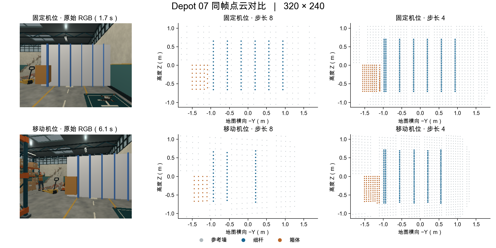
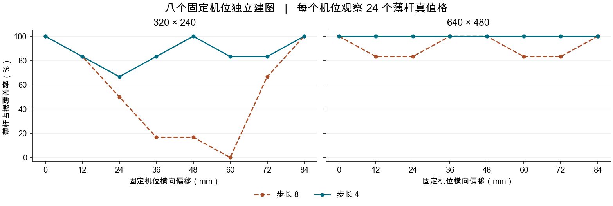
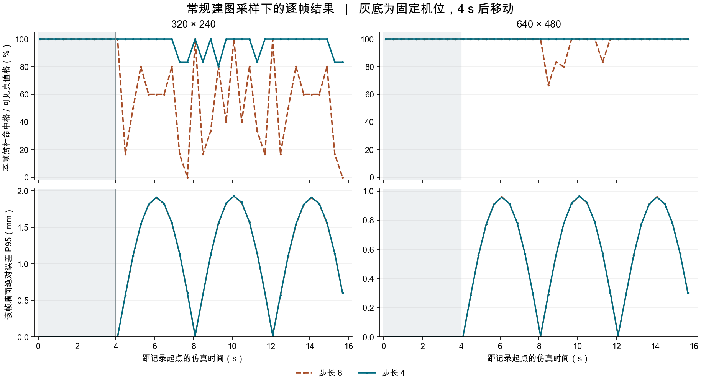

# Depot 07 点云投影与薄障碍物仿真验收

2026-11-28，测量版本 `b39690c`。**C 的受控相机仿真通过。** 在 320×240 的八个独立固定机位，步长从 8 降至 4 后，薄杆的地图占据覆盖率从 54.2% 提高到 87.5%。在相机平移并转向时，两档步长的墙面距离误差 P95 均为 1.816 mm。移动段单帧建图耗时 P95 从 5.85 ms 增至 21.02 ms。[结构化测量结果](measurements.json)

## 固定与移动机位

在 Depot 07 南侧通道布置标定台。相机初始位置在世界坐标 (−2.00, −4.85, 1.35) m，沿正 X 方向看向已知平墙。墙面距初始机位 4.05 m。在墙前 2.55 m 深度层放置六根宽 20、25、30、40、50、60 mm 的矩形竖杆，旁边放置一个独立箱体。竖杆和箱体与墙属于不同体素层。

第一段固定 4 仿真秒，随后 12 秒同时横移、转向，编码器实测横移跨度 1.040 m、偏航跨度 22.92°。Gazebo Harmonic 实际渲染 320×240、640×480 两组同轴 RGB-D 相机，以 10 Hz 采集，ROS 2 Jazzy 经桥接接收，RViz 已显示实时 RGB。地图输入使用深度图、实际 CameraInfo 和曝光时刻的编码器 TF。已知几何和 Gazebo 实例标签在离线评分时读取。本次位姿来源为标定台关节编码器，验收范围是相机投影与时刻配准；PX4 飞行估计器的漂移需要飞行数据另测。

两档步长回放同一批原始帧和同一时刻的 TF，调用测量版本的 `PointCloudMapper.integrate`，使用 0.30 m 体素、4.5 m 量程和原有占据信念更新。无效深度不参与投影。主表沿用节点 0.35 秒最小建图间隔，从 10 Hz 输入中每 0.4 秒取一帧，共 10 个固定帧和 30 个移动帧。另对全部 160 帧逐帧重放，结果见结构化测量。

| 分辨率 | 步长 | 固定时墙面 P95（mm） | 移动时墙面 P95（mm） | 移动时墙面有符号误差 2.5% 至 97.5%（mm） | 移动时箱体表面 P95（mm） |
|---|---:|---:|---:|---:|---:|
| 320×240 | 8 | 0.0011 | 1.816 | −1.819 至 +1.810 | 6.50 |
| 320×240 | 4 | 0.0011 | 1.816 | −1.816 至 +1.814 | 6.61 |
| 640×480 | 8 | 0.0011 | 0.909 | −0.911 至 +0.906 | 3.52 |
| 640×480 | 4 | 0.0011 | 0.909 | −0.911 至 +0.907 | 3.42 |

墙面误差取可见墙点到已知平面的法向绝对距离，按阶段合并有效命中点求 P95。评分使用渲染标签并去掉轮廓边缘两像素。固定机位与墙正对，距离直接沿相机前轴测量。移动时按曝光 TF 变换到地图系。箱体按到已知有限长方体表面的距离评分。检查墙面中央 3.0 m 宽、1.5 m 高、前后各约 0.45 m 的区域，40 帧 × 4 配置的地图均只出现一个占据层，层中心为 X = 4.05 m。

**误差来源。** 在移动段全部 120 帧、步长 4 下，保持深度和 TF 固定，仅在离线反投影时将水平像素坐标加 0.5 像素。320 和 640 宽图像的墙面 P95 分别从 1.820、0.910 mm 降到 0.00164、0.00162 mm。反向移动 0.5 像素则分别增至 3.640、1.820 mm。这表明本渲染器与发布内参的像素中心约定足以解释这面墙的大部分运动残差。主表使用节点原版投影。

## 薄障碍物的地图覆盖率

每根杆取中间 1.2 m 高度内的四个体素。用渲染标签确定可见像素，再用相机射线与已知杆表面求交，确定可见真值格。覆盖率为这些真值格中在地图里已标为占据的比例。移动段另算该帧深度射线实际命中了多少真值格，以衡量后续视角还能否重新观测到杆。

固定初始视角下，两档步长都保留了全部 24 格。为覆盖采样网格与细杆之间的不同相对位置，第二次仿真从 0 到 84 mm 每 12 mm 设置一个固定机位。每个机位独立从空地图开始，稳定后用两帧建图，按第二帧地图计一次。八个机位共 192 个可见格次。

| 分辨率 | 步长 | 八机位独立建图覆盖率 | 移动段当帧重新命中率 | 移动段地图保留率 |
|---|---:|---:|---:|---:|
| 320×240 | 8 | 104/192（54.2%） | 340/660（51.5%） | 660/660（100%） |
| 320×240 | 4 | 168/192（87.5%） | 632/660（95.8%） | 660/660（100%） |
| 640×480 | 8 | 176/192（91.7%） | 640/660（97.0%） | 660/660（100%） |
| 640×480 | 4 | 192/192（100%） | 660/660（100%） | 660/660（100%） |

移动段继承最初固定视角已观测到的杆，所以两档地图最终都保留了全部 24 格。在杆间同一深度层另外检查 12 个已知空格，每种配置在固定和移动段累计 480 个格次，误占据均为 0。

## RGB-D 配对与耗时

按 RGB 原始采集时间戳去重，以同一时间戳且尺寸、光学坐标系一致的 RGB、深度、CameraInfo 为一对，再核对该时刻可取得编码器 TF。两种分辨率使用各自 RGB-D 传感器发布的共享 CameraInfo，焦距分别是 216.248 和 432.496 px。两次正式录制的每种分辨率均收到预期的 160 个 RGB、160 个深度和 160 个 CameraInfo；时间戳完全一致，TF 缺失 0，**各为 160/160 有效配对**。两种分辨率也有相同的 160 个曝光时刻。

首次试录使用尽力交付订阅。在相同的 160 个预期曝光中，320×240 收到 160 RGB、152 深度，共 152 对；640×480 收到 28 RGB、47 深度，共 12 对。按预期曝光计，配对率分别为 95.0% 和 7.5%。正式录制改用可靠订阅、队列深度 40。这里的满配对率适用于该录制配置；正常飞行仍使用其自身的话题 QoS。

| 分辨率 | 步长 | 投影 P50 / P95（ms） | 建图 P50 / P95（ms） |
|---|---:|---:|---:|
| 320×240 | 8 | 0.096 / 0.166 | 3.81 / 5.85 |
| 320×240 | 4 | 0.169 / 0.281 | 15.64 / 21.02 |
| 640×480 | 8 | 0.200 / 0.359 | 15.27 / 21.36 |
| 640×480 | 4 | 0.541 / 0.882 | 64.04 / 75.66 |

计时来自 Intel Core Ultra 9 275HX、WSL2 同机录制后的移动段回放。每档先用独立空地图预热，每帧交替两档步长的执行顺序。投影计时覆盖深度消息解码、采样和量程裁剪。建图从投影返回计至坐标变换、射线积分和占据信念更新完成，不含 ROS 传输和结果序列化。以上是墙钟时间，每档 30 帧。逐帧全量回放中，320×240 两档的建图 P95 分别为 5.75 和 21.40 ms。

## 证据与复核

仓外运行目录为 `output/depot07-c-20261128.a311sj19/`。交付包 `Depot07-camera-C-20261128.tgz` 包含两次正式录制的逐帧 RGB、米制深度、标签、TF、ROS 流时间戳、场景与采集脚本、逐帧评分、RViz 截图和复现步骤。SHA-256 为 `97b60624a39328a773eb02f06ac6ad217ce08e98a43ea51452d208ff64939191`。主机全量回归为 650 项通过、39 项跳过。运行机使用独立 Gazebo 分区、ROS 域和显示会话。
